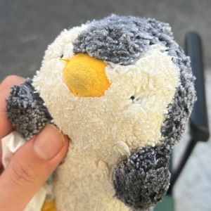

[//]: <I apologise the poor quality of the code, or, according to some's opinion, also the content of this file. >

## Hello, and welcome! 你好，欢迎到访！ Hallo, willkommen bei mir!  

This is the Github Profile Page of JiansheRdN's. I am currently a IB student who would like to do a major in computer science in university. My other interests are: language studies, digital typesetting/LaTeX, and []. My personal homepage: [jiansherdn.github.io](jiansherdn.github.io). 

欢迎来到建设北路（JiansheRdN）的Github个人主页。我是一名立志于计算机专业的IB学生，其他兴趣有：语言学习、电子排版/LaTeX和【滚木（划掉）】。我的个人主页是：[jiansherdn.github.io](jiansherdn.github.io)。

Dies ist die GitHub-Profilseite von JiansheRdN. Ich bin derzeit Oberschüler beim IB-Programm, der in der Zukunft Informatik an der Universität studieren wollte. Meine anderen Hobbys: Sprachenlernen, digitales Schriftsetzen, und []. Meine persönliche Homepage: [jiansherdn.github.io](jiansherdn.github.io).

## 企鹅。

Below is a penguin. It is only a penguin, nothing special. Really. 

*Why would a penguine have its Github page?*

这是一只企鹅。只是一只企鹅。真的。

